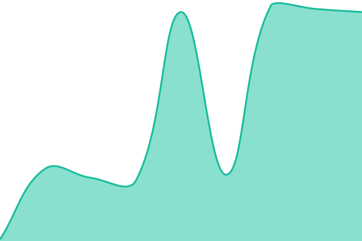
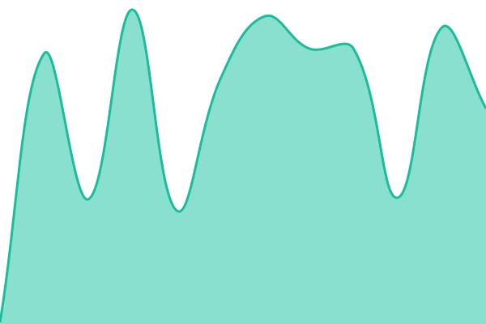

# [📈 Status atual](https://status.mobiari.com): <!--live status--> **Todos os sistemas estão operacionais**

This repository contains the open-source uptime monitor and status page for [Develari](https://develari.com), powered by [Upptime](https://github.com/upptime/upptime).

With [Upptime](https://upptime.js.org), you can get your own unlimited and free uptime monitor and status page, powered entirely by a GitHub repository. We use [Issues](https://github.com/Develari/status/issues) as incident reports, [Actions](https://github.com/Develari/status/actions) as uptime monitors, and [Pages](https://status.mobiari.com) for the status page.

## [📈 Live Status](https://demo.upptime.js.org): <!--live status--> **Todos os sistemas estão operacionais**

<!--start: status pages-->
<!-- This summary is generated by Upptime (https://github.com/upptime/upptime) -->
<!-- Do not edit this manually, your changes will be overwritten -->
<!-- prettier-ignore -->
| URL | Status | History | Response Time | Uptime |
| --- | ------ | ------- | ------------- | ------ |
|  [API](https://api.mobiari.com/health/ready) | No ar | [api.yml](https://github.com/Develari/status/commits/HEAD/history/api.yml) | 

 65ms
     
 | 

<a href="https://status.mobiari.com/history/api">100.00%</a>
    

|  [Painel](https://app.mobiari.com) | No ar | [painel.yml](https://github.com/Develari/status/commits/HEAD/history/painel.yml) | 

 132ms
     
 | 

<a href="https://status.mobiari.com/history/painel">100.00%</a>
    

|  [Site](https://mobiari.com) | No ar | [site.yml](https://github.com/Develari/status/commits/HEAD/history/site.yml) | 

 178ms
     
 | 

<a href="https://status.mobiari.com/history/site">100.00%</a>
    

<!--end: status pages-->

[**Visit our status website →**](https://status.mobiari.com)

## 📄 License

- Powered by: [Upptime](https://github.com/upptime/upptime)
- Code: [MIT](./LICENSE) © [Anand Chowdhary](https://anandchowdhary.com)
- Data in the `./history` directory: [Open Database License](https://opendatacommons.org/licenses/odbl/1-0/)
